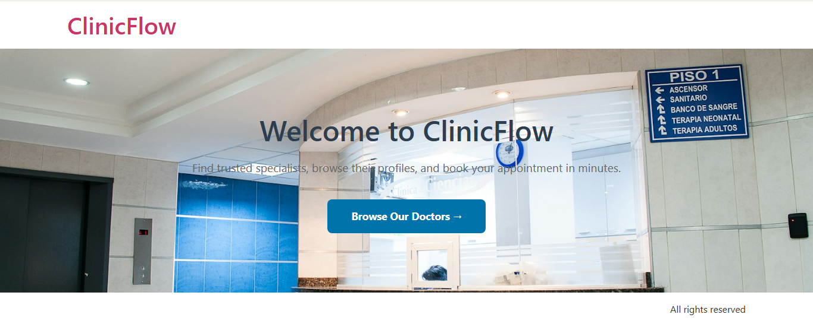
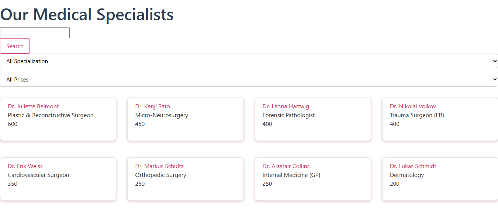
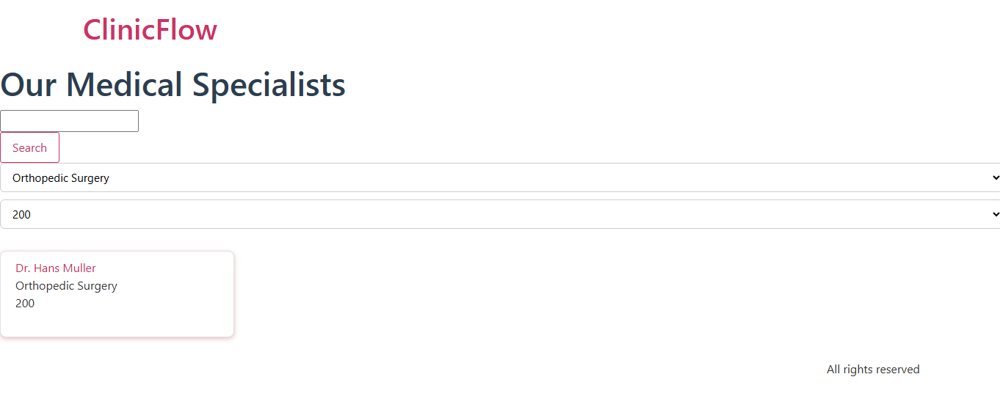
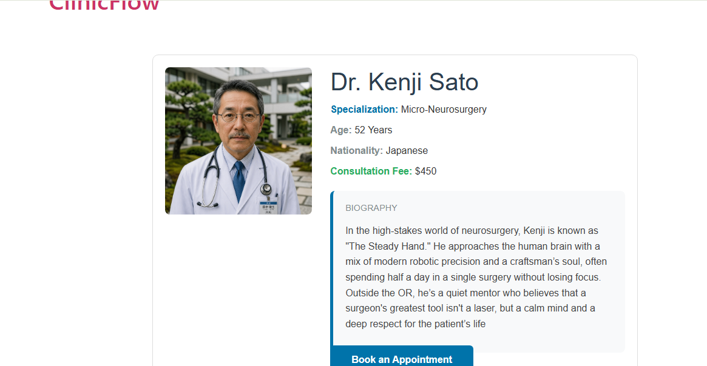
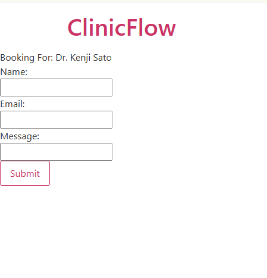

# ClinicFlow - Medical Booking & Specialist Directory Theme

ClinicFlow is a lightweight, custom-built WordPress child theme designed for modern medical clinics and healthcare providers. 
Built with a focus on clean code, responsiveness, 
it provides an intuitive platform for patients to discover specialists and submit appointment booking requests.

---
## 📸 Screenshots & UI Preview





---

## 🔑 Key Features

* **Custom Specialist Directory (CPT):** Structured Custom Post Type for doctors and medical specialists.
* **Advanced Filtering & Search:** Dynamic filtering by specialization, fee range, and keyword search.
* **Specialist Profile Pages:** Detailed dynamic single template displaying bio, age, nationality, consultation fee, and expertise.
* **Dynamic Booking Form:** Integrated appointment request system that automatically captures and passes physician parameters.
* **Clean & Modular Codebase:** Standard WordPress coding practices using PHP, Custom Post Types, and Advanced Custom Fields (ACF).

---

## 🛠️ Tech Stack & Tools

* **Core:** WordPress, PHP, HTML5, CSS3
* **Custom Fields & Architecture:** Advanced Custom Fields (ACF), Custom Post Types (CPT)
* **Parent Theme:** Hello Elementor (Child Theme Architecture)
* **Version Control:** Git & GitHub Workflow

---

## 📂 Theme Structure & Template Organization

```text
hello-elementor-child/
├── functions.php               # Theme setup, CPT registration, & backend logic
├── style.css                   # Custom theme styling
├── page-home.php               # Custom homepage template
├── archive-doctor.php          # Doctors directory & filtering template
├── single-doctor.php           # Individual doctor profile template
├── CONTAXT-US.php              # Booking/contact form template
├── template-parts/             # Overrides parent theme archive template
└── README.md                   # Project documentation

---

## Requirements
- WordPress with the Hello Elementor parent theme
- Advanced Custom Fields (ACF) plugin
- ACF fields on the `doctor` post type: doctor_photo, specialization, age, nationality, consultation_price, short_bio
- A page using the "Contact" template; booking emails use wp_mail(), which needs SMTP on a real host
